<p align="center">
  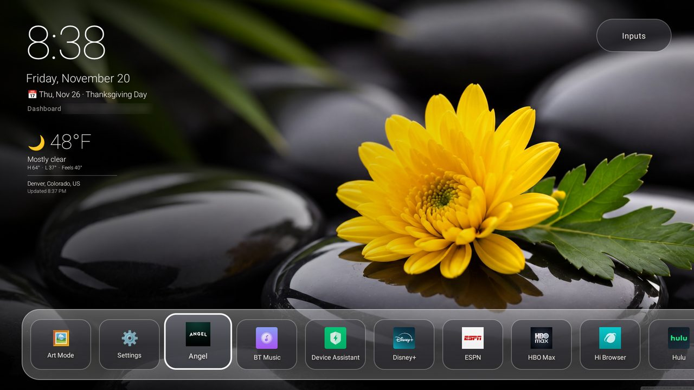
</p>

<h1 align="center">CanvasFrame</h1>

<p align="center">
  <b>A clean home screen and web dashboard that link the TVs you already own into a local mesh.</b><br>
  Google TV / Android TV (no root) · rooted LG webOS · a Windows companion app
</p>

---

CanvasFrame replaces your TV's ad-filled home screen with a quiet one: a clock, the weather, your calendar and your own
photos. Every TV gets its own dashboard in the browser, so you can run it from a phone or laptop. Once you have more than
one, the TVs link up with each other. They share photos and settings, know which room they are in, show the same picture
at the same moment, and pass along things like a doorbell ring, so you can set things up from any of them.

There is no cloud account and no server to keep running. Everything stays on your home network.

## Start here

| You have | Go to |
|---|---|
| A Google TV or Android TV (Hisense, Valerion, others) | [Install on Google TV / Android TV](#install-on-google-tv--android-tv) |
| An LG TV that is already rooted (Homebrew Channel) | [Install on a rooted LG](#install-on-a-rooted-lg-webos) |
| A Windows PC that uses a TV as its monitor | [CanvasFrame Link for Windows](#canvasframe-link-for-windows) |
| UniFi Protect cameras (a doorbell, for example) | [UniFi Protect alerts](#unifi-protect-alerts) |
| Home Assistant, or plans for it | [Home Assistant and the API](#home-assistant-and-the-api) |
| A question about how the TVs work together | [The whole-house picture](#the-whole-house-picture) |
| A quick look at what the dashboard can do | [A tour of the dashboard](#a-tour-of-the-dashboard) |

## How it works

| Piece | What it is |
|---|---|
| **The home screen** | An app that takes over the TV's Home button. On Android it's a normal app; on LG it's a small web app plus a service that runs on the TV. |
| **The dashboard** | A web page every TV serves itself at `https://<tv-address>:9443`. Same page, same look, on every platform. |
| **The mesh** | The TVs talk to each other directly and keep one shared setup in sync. No TV is in charge. |
| **CanvasFrame Link** | An optional Windows tray app: all your TVs in one window, and the "my PC's monitor follows my PC" link. |

**No root on Google TV, nothing uninstalled, and every change can be undone.** On Android, CanvasFrame gets its extra
abilities through the TV's own developer connection (ADB), which you switch on once. On LG it needs a TV that has
already been rooted with the community tools. It does not root the TV for you.

## What you get

### The home screen, made yours

| | |
|---|---|
|  | 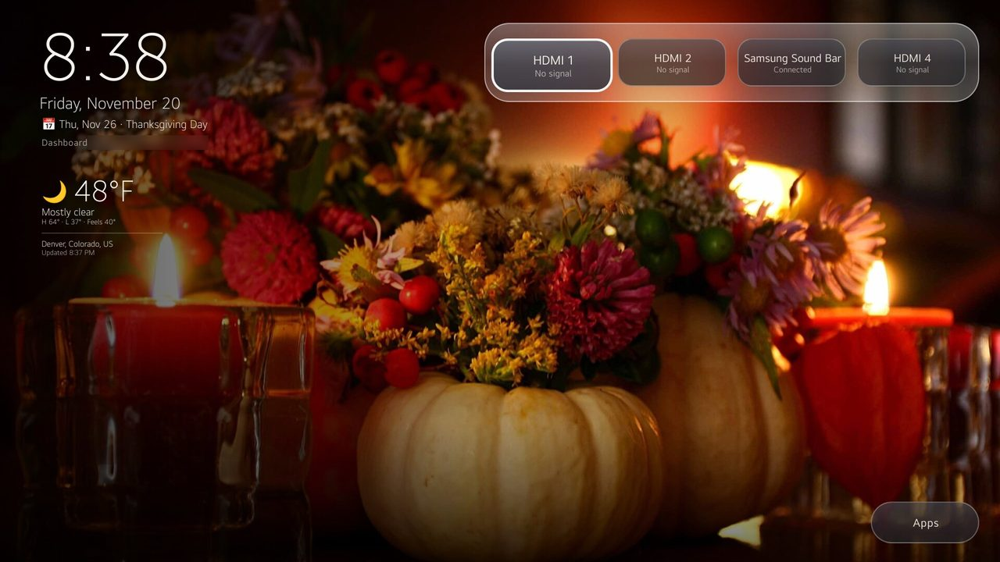 |
| *Hisense (Google TV): your photo, the clock, the next calendar event, the weather, and the app row.* | *LG (webOS): the same layout, here with the Inputs drawer open, showing what's connected.* |

Everything on the home screen is set from the dashboard, and changes show on the TV within a second.

| Part | What you can change |
|---|---|
| **Clock** | 12- or 24-hour. Under the date it shows your next calendar event ("Thu, Nov 26 · Thanksgiving Day"). |
| **Weather card** | On or off, the town (search by name), °F or °C. Press → on it for the hourly, weekly and animated radar views. Data from Open-Meteo: free, no account, only the town's coordinates are sent. |
| **Calendar** | Add any iCal link (Google, Outlook, iCloud, a sports schedule). Press → on the clock for the month view. Repeating events and daylight-saving changes are handled. |
| **Inputs and apps** | Two drawers that slide away when you're not using them. Hide apps you never use, rename the rest, and hide inputs with nothing plugged in. |
| **Look** | *Frame* (no boxes, text straight on the photo) or *Glass* (soft frosted cards). The controls can hide after a few seconds or stay put. |
| **Background photos** | Upload from a phone or computer (JPEG, PNG, WebP, HEIC; large photos are resized to 4K). Choose how often the photo changes. Text stays readable on any picture: CanvasFrame shades softly behind the clock and weather. |
| **Show now** | Tap a photo on the dashboard to put it on the TV straight away. |

#### Tagging: the right photo for the moment

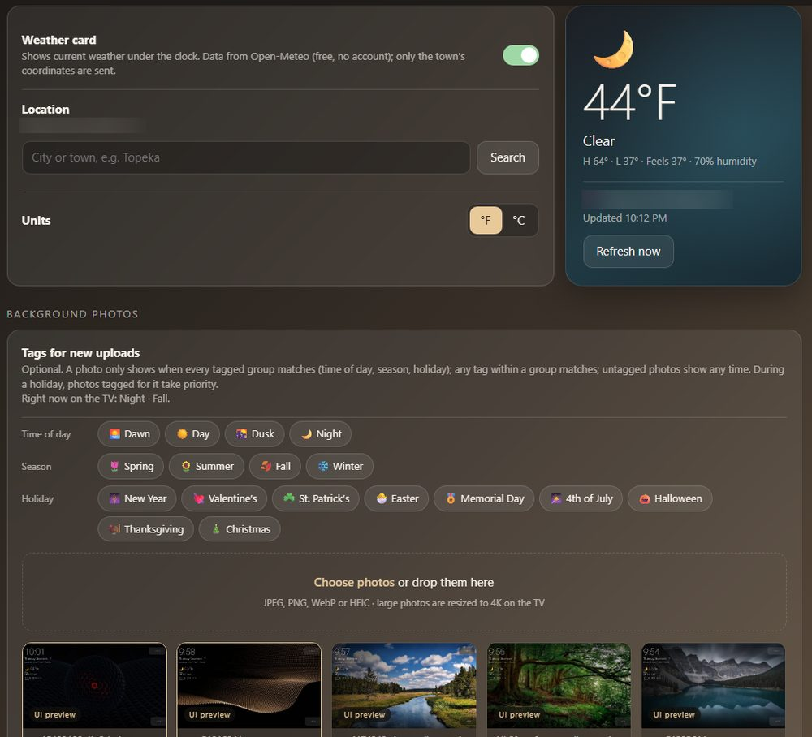

Each photo can carry tags from three groups. You can tag new uploads as you add them, or retag any photo later.

| Group | Tags | When a tag is "on" |
|---|---|---|
| **Time of day** | Dawn, Day, Dusk, Night | Worked out from **sunrise and sunset at your weather location**. Dawn runs from 45 minutes before sunrise to an hour after it, and dusk from an hour before sunset to 45 minutes after. Without a location, it uses fixed hours. |
| **Season** | Spring, Summer, Fall, Winter | By month (spring is March to May, and so on). |
| **Holiday** | New Year, Valentine's, St. Patrick's, Easter, Memorial Day, 4th of July, Halloween, Thanksgiving, Christmas | A window around each day: Halloween from October 15, Christmas from December 1 to the 26th, Thanksgiving the week before. Easter, Memorial Day and Thanksgiving are **calculated for each year**. |

How the TV picks a photo:

1. **Untagged photos can show any time.** Tags only ever narrow things down.
2. **Within a group, any tag matches.** A photo tagged *Dusk + Night* shows in the evening and all night.
3. **Every group you used must match.** A photo tagged *Winter + Night* shows only on winter nights. A photo tagged only
   *Winter* shows all day in winter.
4. **Holidays come first.** While a holiday is on, photos tagged for it are the only ones in rotation. The pumpkins
   take over in late October, then step aside on November 1.
5. **It changes at the right moment.** When dawn turns to day, or a holiday starts, the TV moves to a fitting photo
   at once instead of waiting for the next change.

The dashboard shows what's "on" right now ("Right now on the TV: Night · Fall") and how many photos fit ("32 photos ·
18 in rotation now"). With **Same photo together** on, linked TVs apply the same rules to the photos they all have, so
they still agree on one picture.

### Screen savers

| | |
|---|---|
|  | 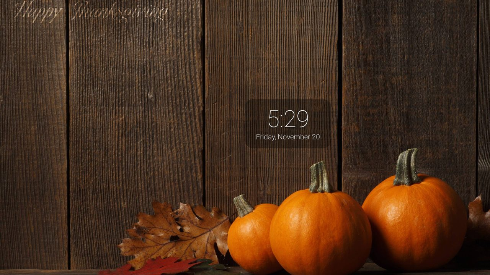 |
| *CanvasArt: your photos one at a time, optionally in a white or black mat, like a print on the wall.* | *A small clock and weather panel drifts slowly, so you can tell it's a screen saver.* |

- **They dim for real.** At night CanvasFrame lowers the TV's actual backlight, not just a grey layer on top. It fades
  further late at night and comes straight back when someone picks up the remote.
- **Dim by room light.** TVs with a light sensor use it. **TVs without one borrow a reading from another TV in the
  same room** (see [Borrowed senses](#borrowed-senses-a-tv-without-a-sensor-uses-its-neighbours)).
- **OLED care.** On an OLED, the idle home screen fades to black after a while, which saves power and protects the panel.
- **Remote sounds** use the TV's own clicks, and you can switch them off.

## A tour of the dashboard

Every TV serves its own dashboard at `https://<tv-address>:9443`. Open it on a phone, tablet or computer on your network.
The TV makes its own certificate, so your browser asks you once to trust it. The tabs are the same on every platform.
A tab only appears when the TV supports it.

**The header** shows the TV's name, model and address, with a monogram badge in the brand's colours. The **TV picker**
on the right jumps to any other CanvasFrame TV, already signed in. If the TV you're on stops answering, a banner offers
the others.

<details open>
<summary><b>Overview: what's on, and how the TV is doing</b></summary>

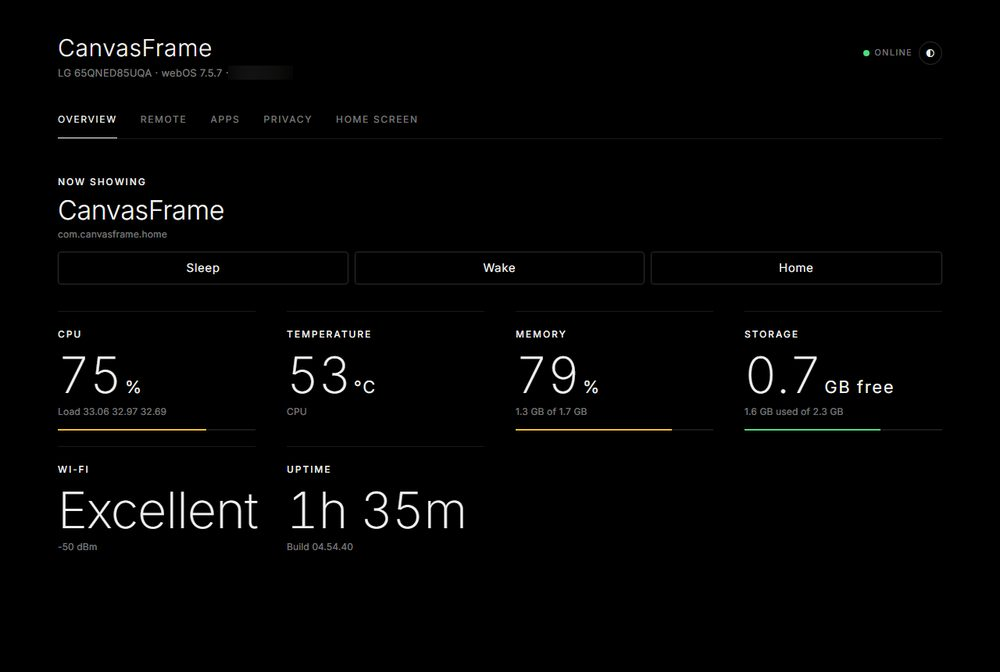

- **Your CanvasFrame TVs**: a live wall of every linked TV, showing what each one is showing right now (photo, app,
  input, screen saver or off), dimmed like its screen. Tap a tile to open that TV. A **Wake** button appears on TVs that
  are off.
- **Now showing**, with Sleep, Wake, Home and **Screen saver** buttons.
- **Health**: CPU, temperature (with a one-hour graph on LG), memory, storage, Wi-Fi strength, uptime, and the Magic
  Remote's battery on LG.
- **CanvasFrame for Windows**: download the PC app from here.
</details>

<details>
<summary><b>Remote: a full remote on your phone</b></summary>

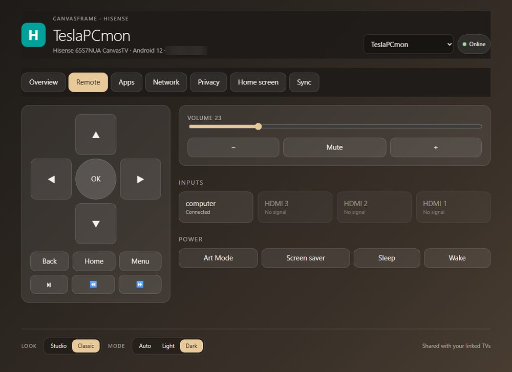

D-pad, Back, Home, Menu, play/pause, volume and mute. The inputs show what's connected. Power: Sleep, Wake, Screen saver
(and Art Mode on a Hisense CanvasTV).

**Your computer** (when a PC is linked): which input the PC uses, its picture mode, and what the TV does when the PC
turns its display off.
</details>

<details>
<summary><b>Apps: tidy the app row</b></summary>

- Hide apps from the home screen, or rename them.
- **Android:** turn bundled apps off and back on. Nothing is uninstalled.
- **LG:** install an `.ipk` (upload or link), and remove apps LG allows to be removed.
</details>

<details>
<summary><b>TV settings (LG): the menus without the menus</b></summary>

Picture and power, sound and eARC, HDMI, Game Optimizer, and connected devices. Only settings this TV actually has are
listed, and choices LG greys out stay greyed out. Storage shows what's using space, including LG's in-store demo
videos, which can take a gigabyte and can be removed.
</details>

<details>
<summary><b>Network</b></summary>

- **LG:** choose DNS servers, or go back to the router's.
- **Android:** see the DNS servers and set the time server.
</details>

<details>
<summary><b>Privacy: ads, tracking and who can use the dashboard</b></summary>

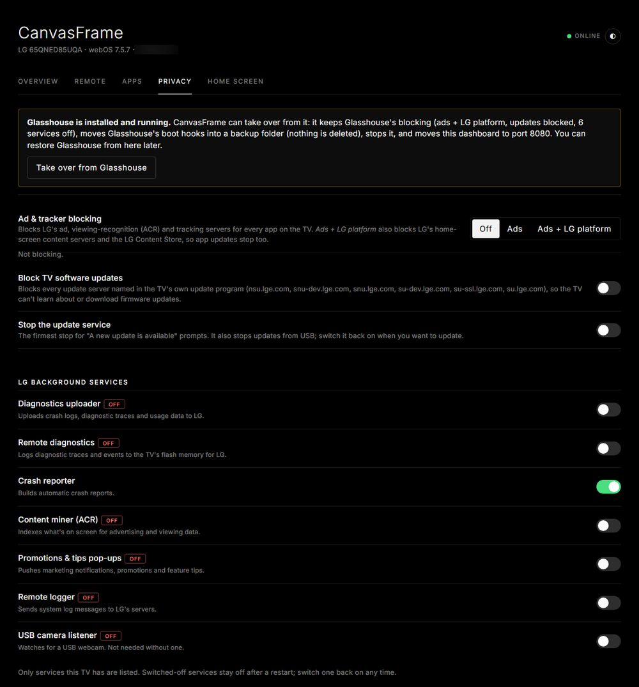

- **LG:**
  - Block ads and trackers, and optionally LG's own platform servers.
  - Block firmware updates, or stop the update service entirely.
  - Switch off LG's background services one by one (diagnostics upload, content recognition, promotions, remote logging).
  - Limit ad tracking, and reset the advertising ID.
- **Android:** ad-blocking Private DNS, and the ACR ("what are you watching") tracker switch.
- **Both:**
  - **Dashboard sign-in** with any authenticator app (Google, Microsoft, 1Password, Aegis). Add one per person, and a
    browser stays signed in for 30 days.
  - **API keys**, for other TVs and Home Assistant.
  - This TV's certificate fingerprint.
</details>

<details>
<summary><b>Home screen: everything in the section above</b></summary>

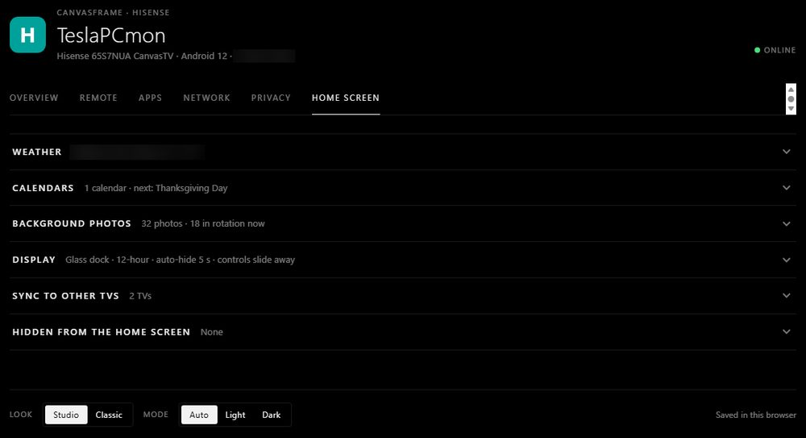

Weather, calendars, background photos and tags, display (look, clock, auto-hide), screen saver and dimming, and hidden
apps. Each section folds up to a one-line summary, so you can see the whole setup at a glance.
</details>

<details>
<summary><b>Sync: the whole house</b></summary>

The TVs, their rooms and what each is doing, rooms and which rooms are next to each other, screen savers together,
photo consistency across TVs, storage per TV, linked TVs, and UniFi Protect alerts. Covered in
[The whole-house picture](#the-whole-house-picture).
</details>

**Look and mode.** At the bottom of every page you can choose *Studio* or *Classic*, light or dark. The choice is shared
with every linked TV's dashboard.

## The whole-house picture

One TV running CanvasFrame works fine on its own. Link several and they become a **mesh**: a small network of equals that
keeps one shared setup up to date on every TV.

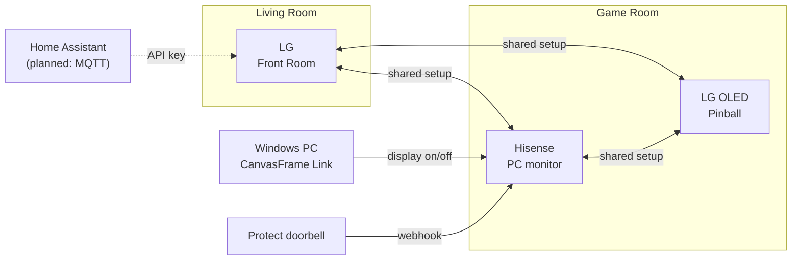

**What every TV keeps a copy of:**

| Shared | Stays per TV |
|---|---|
| The list of TVs and their rooms, which rooms are next to each other | The TV's name, room, and hidden apps |
| Photos, their tags, and deletions | Its TV, privacy and network settings |
| Home-screen settings (weather, clock, timings, theme) and calendars | Its screen saver choice and how much it dims |
| Sign-in authenticators, and "sign in once" for every TV | Its API keys |
| The UniFi Protect setup | Which Protect alerts it shows, and where |
| Live state: what each TV is showing, its backlight, room light | |

**How it stays in sync.** A change made on any TV's dashboard is pushed to the others within a second or two. Every TV
also pulls from the TVs it can reach every 15 seconds, which covers one-way networks: a TV on a guest network that can't
call the others still gets everything when they call it. Each item carries a timestamp, so the newest change wins.
Deletions are remembered for a week, so a deleted photo stays deleted.

**What that makes possible:**

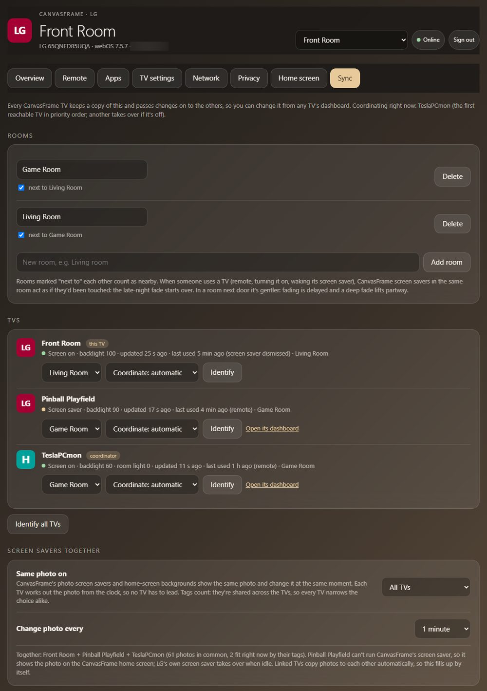

- **"Your CanvasFrame TVs"**: a live wall on every dashboard showing what each TV is showing right now, dimmed like its
  screen. Tap one to open its dashboard, already signed in.
- **Same photo together.** Screen savers and backgrounds in a room (or the whole house) change to the same photo at the
  same moment. No TV leads: each one works the photo out from the clock.
- **Rooms that notice each other.** Pick up the remote in one room and the screen savers there stop their night fade.
  Next door, the fade is gentler.
- **Photos copy themselves.** Upload once and the photo reaches every TV that has room for it. A storage bar per TV shows
  who is getting full.
- **Sign in once.** Signed in on one TV? Open another from the wall or the TV picker and it lets you straight in. "Sign
  out on all TVs" ends that sign-in everywhere.
- **No single point of failure.** If the TV you're talking to stops answering, the dashboard offers the others, and any
  of them can make the same change. A "coordinator" role exists for jobs that need one TV, but it moves automatically
  to whichever TV is on.
- **Wake-on-LAN.** TVs that are off show a Wake button on the wall (on Wi-Fi this needs the TV's "Turn on via Wi-Fi" option).

### Borrowed senses: a TV without a sensor uses its neighbour's

A design goal from the start: **a TV should never be limited by the hardware it happens to have.** One TV in a room may
have an ambient light sensor, another may have none, and a third may have one that only works with some picture
settings. Inside CanvasFrame's mesh, a sensor reading belongs to the room, not to the TV that took it.

| | Front Room (LG QNED) | Pinball (LG OLED) | PC monitor (Hisense) |
|---|---|---|---|
| Own light sensor | Yes, but it only reports while LG's AI Brightness is on | Yes, and it reports | Yes, but rough and uncalibrated |
| With *Automatic*, its light comes from | Its own sensor (CanvasFrame turns AI Brightness on), else the freshest TV in its room | Its own sensor | The Pinball: the freshest reading in the same room |

How it works:

1. **Every TV that can read the room shares it.** Each TV publishes its own light reading in the shared setup, next to
   its other live state. It only ever passes on what *its own* sensor measured, never a reading it borrowed, so
   readings can't bounce around the mesh.
2. **Each TV chooses where its light comes from**, in Home screen → Screen saver → *Light from*:
   - **Automatic** (the default): its own sensor if it has a fresh reading, otherwise the freshest reading from
     another TV in the same room.
   - **This TV**: its own sensor only.
   - **A particular TV**: for example the one nearest the window.
3. **Stale readings are ignored.** A reading older than three minutes doesn't count. With no fresh reading anywhere, the
   TV goes back to dimming by the clock, so nothing breaks when the other TV is switched off.
4. **The borrowed reading drives everything a local one would.** How dark the screen saver gets, when "night" starts
   (a dark room counts as night, even at 7 pm), and the late-night fade. A *Brighter / Darker* offset fine-tunes it
   per TV.
5. **No setting is touched unnecessarily.** An LG's sensor only reports while LG's AI Brightness is on. CanvasFrame
   switches that on only when the TV is set to *Automatic* or *This TV*, and back off only if CanvasFrame was the one that turned it on. A TV that
   borrows its light leaves its picture settings alone.

Tested: the Front Room, set to take its light from the Pinball, dimmed by the Pinball's reading (83 % room brightness)
with its own AI Brightness left off. The Hisense, whose own sensor read 0 in a lit room, picked the Pinball by itself on
*Automatic*.

The same idea runs through the rest of the mesh:
- **Activity** is shared as well. Someone using the remote in one room counts as "someone's here" for every screen saver
  in that room, and as a softer hint next door.
- **Home Assistant** is the next source: a motion sensor or a lux sensor in Home Assistant can feed the same room
  readings, so a TV with no sensors at all still knows whether the room is bright or busy.

This is the groundwork for Home Assistant: the TVs already hold a shared, room-aware picture of the house, which a hub
can read and steer.

## UniFi Protect alerts

| | |
|---|---|
| 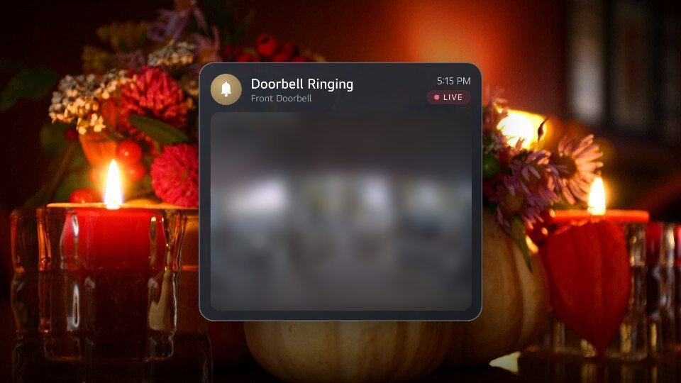 | 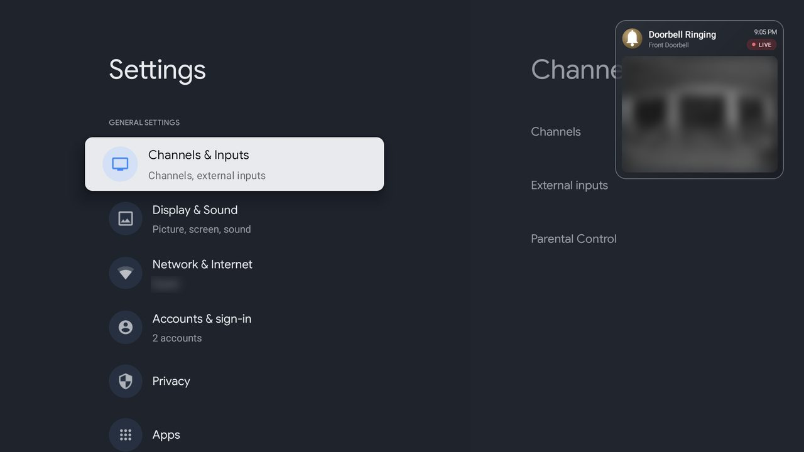 |
| *Over CanvasFrame's own screens: large and centred.* | *Over any other app or input: a compact card in the corner you choose.* |

When Protect sends an alert (someone rings, a person or a package at the door, motion), CanvasFrame shows a card with
the camera's picture on your TVs:

- **Centred** over the CanvasFrame home screen or screen saver.
- **Small, in a corner** over anything else: the PC, live TV, Netflix. On LG, a tiny overlay app draws the card and the
  app underneath keeps the remote.

The card shows the alert (*Doorbell Ringing*, *Person at the Door*, *Package Delivered*, *Motion at the Door*), the
camera's name, the time, and a LIVE badge once the picture is moving. The Hisense plays the camera's live stream. The LGs
show a snapshot that refreshes about once a second.

**Setup**, on any TV's dashboard (Sync tab, UniFi Protect card):

1. Enter your Protect console's address and an API key (UniFi OS → Settings → Control Plane → Integrations).
2. Define your alerts. Each one has a name (the title your TVs show), a camera (for the snapshot and its name), an
   optional RTSP stream for live video, and its own webhook address. A doorbell's ring, person, package and motion alerts
   are there to start with; add one for any other camera or sensor.
3. In Protect: **Alarm Manager → Create alarm**. Pick a trigger and camera, choose the action **Webhook**, and paste
   that alert's address.

Any TV can receive the webhook and it tells the rest. Each TV chooses which alerts it shows, which corner, what size, and
how long the card stays (5 seconds over your PC works well).

## CanvasFrame Link for Windows

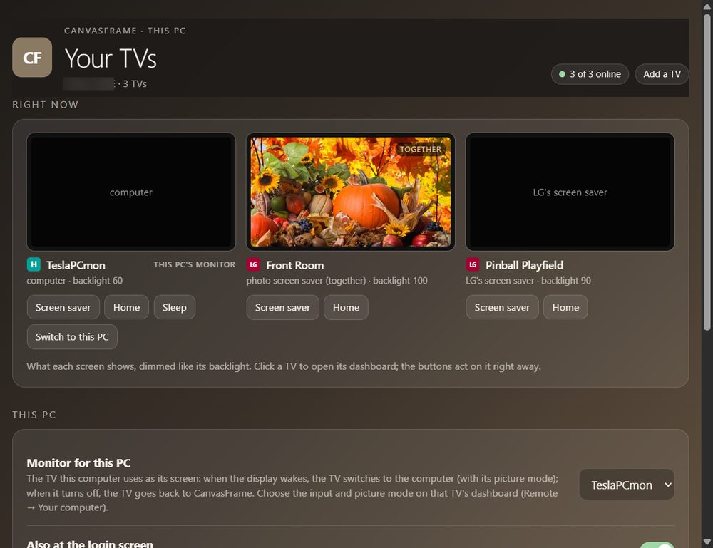

A small tray app. Download it from any TV's dashboard (Overview → *CanvasFrame for Windows*). It installs for your
user, adds itself to the Start menu, and the download already knows which TV it came from.

- **All your TVs in one window**, with the same live wall as the dashboard. Open any TV's full dashboard inside it,
  already signed in.
- **Your monitor follows your PC.**
  - When the PC's display wakes, the TV switches to the PC input and the right picture mode. No remote needed.
  - When the display turns off, the TV goes back to CanvasFrame or its screen saver.
  - An optional Windows service does the same at the login screen.
- **Wakes the TV first** with Wake-on-LAN if it's off.
- **Your choice of "off".** On an LG you can choose what happens when the PC turns its display off: screen off,
  power off, home, or screen saver.
- A guided dialog if the TV needs USB debugging switched on.

Windows SmartScreen will warn the first time because the app isn't code-signed: **More info → Run anyway**.

### A special case: a TV that belongs to one PC

Some screens exist for a single computer: a virtual pinball cabinet's playfield, a racing or flight simulator rig, a
media PC behind the living-room TV, a wall display in a workshop. Nobody wants to hunt for the TV remote every time.
Install CanvasFrame Link on that PC, set **Monitor for this PC** to the TV, and pick on the TV's dashboard what should
happen:

| When the PC... | The TV... |
|---|---|
| starts, wakes or shows the login screen | wakes up (by Wake-on-LAN if it was off), switches to the PC's input, and sets the picture mode you chose (e.g. Game mode for a cabinet, Filmmaker for a media PC) |
| turns its display off or sleeps | does what you chose: back to CanvasFrame, the screen saver, screen off, or power off |
| shuts down | the same as display off |

Turn on **Also at the login screen** and a small Windows service does this before anyone signs in, so a cabinet that
boots straight to its front end needs no keyboard at all. The picture
mode is set only while that input is on screen, and the TV checks it again shortly after switching, in case the input
settles late.

## Install on Google TV / Android TV

Tested on a Hisense 65S7NUA CanvasTV (Android TV 12) and a Valerion VisionMaster Pro projector (Google TV). Other
Android TV devices should work. Hisense-specific extras, such as real backlight dimming, picture modes and the light
sensor, fall back gracefully elsewhere.

| Where | What to do |
|---|---|
| **1. On the TV** | Settings → System → About → click **Build** 7 times. Then Settings → System → Developer options → **USB debugging** on (on Google TV it's also called network debugging). Note the TV's IP address. |
| **2. On your computer** | Install [ADB](https://developer.android.com/tools/releases/platform-tools) (`winget install Google.PlatformTools` on Windows). To build from source you also need JDK 17+ and the Android SDK (`platforms;android-31`, `build-tools;35.0.0`). |
| **3. Build and install** | Run the commands below. The TV asks **"Allow USB debugging?"** once: tick *Always allow* and choose Allow. |
| **4. Make it Home** | `./set-home.ps1` points the Home button at CanvasFrame. `./debloat.ps1` optionally turns off ad and tracking apps. `./restore.ps1` undoes both. |

```powershell
./launcher/build.ps1                                   # builds launcher/CanvasFrame.apk (makes a signing key on first run)
adb connect <tv-ip>:5555
adb install -r launcher/CanvasFrame.apk
adb shell pm grant com.canvasframe.home android.permission.WRITE_SECURE_SETTINGS     # DNS, screen saver, input switching
adb shell appops set com.canvasframe.home SYSTEM_ALERT_WINDOW allow                  # alerts over other apps
adb shell pm grant com.canvasframe.home android.permission.READ_EXTERNAL_STORAGE     # photos
adb shell am start -n com.canvasframe.home/.HomeActivity                             # start it
./set-home.ps1 -s <tv-ip>:5555
```

Then open `https://<tv-ip>:9443` in a browser.

> **Keep `launcher/canvasframe.keystore` safe.** It is the app's signing key and is not in git. Updates must be signed
> with the same key, or you'll have to uninstall first and redo the permissions.

## Install on a rooted LG (webOS)

CanvasFrame for LG runs on TVs that are **already rooted**, with the Homebrew Channel and SSH as root. Rooting depends on
your model and firmware. See the community guides at [webosbrew.org](https://www.webosbrew.org/). Tested on an LG
QNED85 (webOS 7) and an LG OLED C4 (webOS 10).

| Where | What to do |
|---|---|
| **1. On the TV** | Root it and install the Homebrew Channel (community guide). In Homebrew Channel settings, turn on **SSH** and **root**. |
| **2. On your computer** | Python 3 and an SSH key the TV accepts (`ssh root@<tv-ip>` should log in without a password). [How to set up the key ↓](#ssh-key) |
| **3. Deploy** | `./webos/deploy.ps1 -Tv <tv-ip>`. It builds the package, installs it, adds a boot hook so the service starts with the TV, and starts it. |
| **4. Open it** | Press Home: CanvasFrame opens instead of LG's home. The dashboard is at `https://<tv-ip>:9443`. |

<a name="ssh-key"></a>
<details>
<summary><b>Setting up an SSH key the TV accepts (step 2)</b></summary>

The deploy script logs in to the TV as root over SSH many times, so it needs a key instead of a password. You do this
once per computer.

**1. Make a key on your computer** (skip if you already have `~/.ssh/id_ed25519.pub`). Windows 10 and 11 include
OpenSSH, so this works in PowerShell as it is:

```powershell
ssh-keygen -t ed25519                     # press Enter to accept the file name; a passphrase is optional
```

**2. Log in to the TV once with the password.** With SSH switched on in the Homebrew Channel, the TV accepts `root` with
the Homebrew Channel's default password (see its documentation; at the time of writing it is `alpine`):

```powershell
ssh root@<tv-ip>                          # answer "yes" to the fingerprint question, then type the password
exit
```

**3. Copy your public key to the TV.** Copy the file across rather than piping it into `ssh`: Windows PowerShell 5.1
adds an invisible byte-order mark to piped text, which breaks the key.

```powershell
scp $env:USERPROFILE\.ssh\id_ed25519.pub root@<tv-ip>:/tmp/key.pub
ssh root@<tv-ip> "mkdir -p /home/root/.ssh && cat /tmp/key.pub >> /home/root/.ssh/authorized_keys && chmod 700 /home/root/.ssh && chmod 600 /home/root/.ssh/authorized_keys && rm /tmp/key.pub"
```

On macOS or Linux, `ssh-copy-id root@<tv-ip>` does the same in one step.

**4. Check it.** This should print `ok` without asking for a password:

```powershell
ssh root@<tv-ip> echo ok
```

**5. Change the default password** now that you don't need it: `ssh root@<tv-ip>`, then `passwd`. Everyone who knows
the Homebrew Channel knows the default.

Using more than one computer? Repeat steps 1, 3 and 4 on each one. Each computer's key goes on its own line in
`authorized_keys`.

---
</details>

---

### What's different on LG

- The Home and Input buttons open CanvasFrame's screens instead of LG's.
- The screen savers (clock, or your photos with the drifting info panel) replace LG's own. That works where LG's screen
  saver is the older QML kind (webOS 7). On webOS 10 the TV keeps LG's screen saver, and CanvasFrame dims the idle home screen instead.
- If Glasshouse is installed, CanvasFrame can take over from it (and give it back).
- An LG can also act as a hub for **Roku TVs** on the same network: status, inputs, apps and remote from the same dashboard.

## Home Assistant and the API

CanvasFrame is being built **Home Assistant first**. Where Home Assistant exists, it is meant to be the brain: it
knows who is home and which lights are on, and it decides what the house does. CanvasFrame exposes each TV to it and
takes commands from it. Without Home Assistant, CanvasFrame's own logic (clock dimming, room activity) keeps working on
its own.

**Today: a local REST API on every TV.** Create a key on a TV's dashboard (Privacy → API keys) and send it as the
`X-CanvasFrame-Key` header over HTTPS. Every POST also needs `X-CanvasFrame: 1`.

| Call | What it does |
|---|---|
| `GET /api/status` | Name, model, platform, what's on screen, CPU, temperature, storage, Wi-Fi |
| `GET /api/site` | The whole shared house: every TV, room, live state (screen on / saver / off, backlight, room light) |
| `POST /api/site {activity:"motion"}` | Tell the TVs someone is in the room (a motion sensor hook) |
| `POST /api/key`, `/api/input`, `/api/launch`, `/api/volume` | Remote keys, switch input, open an app, volume |
| `POST /api/screensaver {preview:true}` | Start the screen saver now |
| `POST /api/pc {event:"on"\|"off"}` | The PC-monitor link: switch to the PC (with picture mode) or back |
| `POST /api/wol {id}` | Wake another TV with Wake-on-LAN |
| `GET /api/roomlight` | The room-light reading and how much the TV would dim |
| `POST /api/doorbell/test {kind}` | Show a doorbell alert (good for automations) |
| `GET /api/tls` | The TV's certificate fingerprint, to pin it |

<details>
<summary><b>Example: start the screen saver from a script</b></summary>

```bash
curl -sk -X POST https://<tv-ip>:9443/api/screensaver \
  -H "X-CanvasFrame-Key: cfk_…" -H "X-CanvasFrame: 1" \
  -H "Content-Type: application/json" -d '{"preview":true,"openHome":true}'
```
</details>

**Planned: MQTT with Home Assistant discovery.** Each TV announces itself as a device with entities: screen state, what's
showing, backlight, room light, CPU temperature, a screen saver switch, a doorbell event. Home Assistant adds them
automatically. MQTT is a better fit than REST for a growing house, because TVs come and go, nothing has to poll, and the
broker stays the single meeting point. The REST API stays as the direct path.

**Also planned:**
- Rooms in CanvasFrame matched to Home Assistant areas.
- Presence and lights deciding when screen savers start and how dark they get.
- The coordinator role relaying for TVs that can't reach the broker.

## Privacy and security

- **LAN only.** Don't forward the dashboard's ports on your router. Plain HTTP from another device is redirected to HTTPS,
  and API keys are refused over HTTP.
- **Sign-in is optional** and uses ordinary 6-digit authenticator codes, with lock-outs after wrong guesses. Every TV's
  dashboard explains how to reset it if you get locked out.
- **TVs check each other's certificates.** Each TV remembers the others' certificates on first contact and refuses
  a TV whose certificate changes.
- **Secrets stay on the TVs.** The doorbell's API key, calendar links and authenticator secrets only travel TV to TV,
  never to a browser.
- **No microphone, no recording.** The Hisense has a built-in mic. CanvasFrame doesn't use it.

## Repository layout

| Path | What it is |
|---|---|
| [`launcher/`](launcher) | The Android app: home screen, screen saver, dashboard server (plain Java, no Gradle) |
| [`launcher/assets/dashboard.html`](launcher/assets/dashboard.html) | The dashboard, shared by every platform |
| [`webos/`](webos) | The LG version: wrapper app, Node service, home page, doorbell overlay app, deploy script |
| [`pc/`](pc) | CanvasFrame Link for Windows (.NET Framework 4.8 + WebView2) |
| `set-home.ps1`, `debloat.ps1`, `restore.ps1` | Android Home takeover and optional debloat, and the undo |

## When something goes wrong

- **The Home button still opens Google TV.** Run `./set-home.ps1` again. Both the Google TV launcher and the setup
  recovery screen have to be out of the way.
- **The TV says "Allow USB debugging?" again.** That happens once per computer. Tick *Always allow*.
- **The dashboard says the certificate isn't trusted.** That's expected the first time (the TV makes its own). Accept it
  once per browser.
- **An LG lost CanvasFrame's screen saver after an update.** The service puts it back within a minute.
- **A linked TV shows "certificate has changed".** It was reset or reinstalled. Remove it from Linked TVs and add it again.

## Questions people ask

<details>
<summary><b>Do I need to root my Google TV?</b></summary>

No. Everything on Android works through the TV's own developer connection, which you switch on in settings. Nothing is
uninstalled, and `restore.ps1` puts the stock home screen back.
</details>

<details>
<summary><b>Can CanvasFrame root my LG?</b></summary>

No. It needs an LG that already runs the Homebrew Channel with root. Whether your TV can be rooted depends on its
firmware. Check the webOS Homebrew community first.
</details>

<details>
<summary><b>Is there a server or an account?</b></summary>

No. Each TV is its own server, and the TVs talk to each other directly. Turn any of them off and the rest carry on.
</details>

<details>
<summary><b>What happens on a TV with no other TVs?</b></summary>

It works on its own. The Sync tab simply has nothing to sync until you link another TV.
</details>

<details>
<summary><b>Why does the doorbell card look different over Netflix than on the screen saver?</b></summary>

On CanvasFrame's own screens the card is large and centred. Over anything else it's a compact card in the corner you
choose, so it doesn't sit in the middle of a film or your desktop.
</details>

## Legal

- CanvasFrame is an independent project. It is not affiliated with or endorsed by Google, Hisense, LG Electronics,
  Valerion, Roku, Ubiquiti or Microsoft. Product names are their owners' trademarks.
- Rooting a TV may void its warranty. You do it at your own risk, with community tools this project doesn't provide.
- The software is provided as is, without warranty of any kind.

## Licence

[MIT](LICENSE). Use it, change it, share it; keep the copyright notice.
